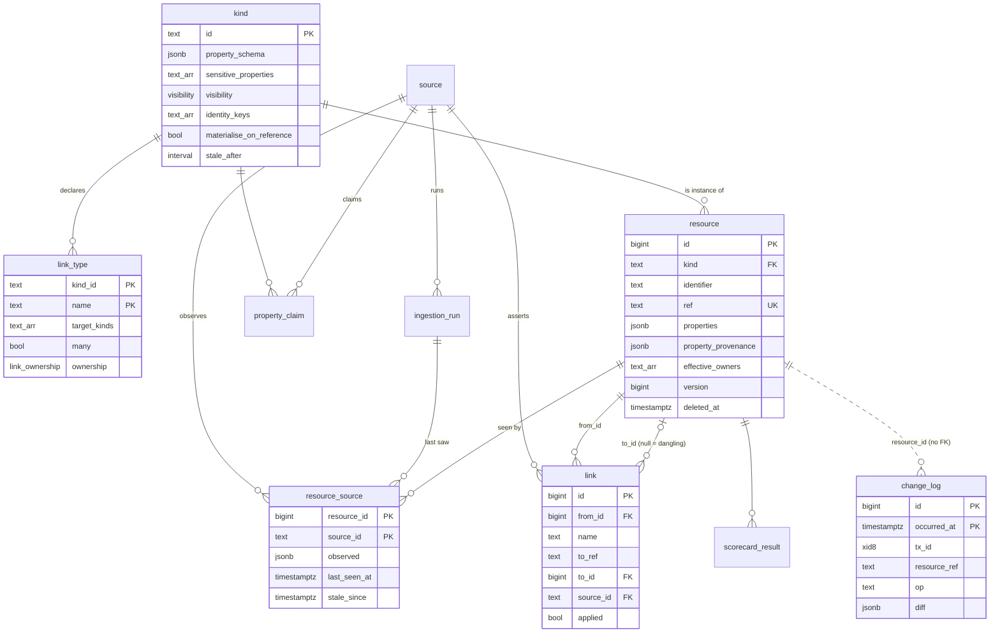

# Data store reference

The PostgreSQL schema of the service catalog: every schema, table, column,
index, function, view and role. No rationale here; see
[explanation.md](./explanation.md) for why it is built this way. The runnable
version is [`demos/data-store/`](../../demos/data-store/), and every name below
is defined in its [`sql/`](../../demos/data-store/sql/) folder.

Contents:

- [Concept map](#concept-map)
- [Entity-relationship diagram](#entity-relationship-diagram)
- [Schemas and roles](#schemas-and-roles)
- [Types](#types)
- [Tables: `catalog`](#tables-catalog)
- [Tables: `authz`](#tables-authz)
- [Write functions](#write-functions)
- [Derivation functions](#derivation-functions)
- [Read surface: `api`](#read-surface-api)
- [OpenFGA projection](#openfga-projection)
- [Invariants](#invariants)
- [Sizing and indexes](#sizing-and-indexes)

Target: PostgreSQL 18. No extensions are required.

A visual version of this page is the
[schema page](../../demos/data-store/index.html). The two are updated together
with every schema change.

---

## Concept map

How the concepts in the [service catalog reference](../service-catalog/reference.md)
map onto database objects.

| Catalog concept | Stored as |
|---|---|
| Kind, its JSON Schema, `visibility`, `identity.keys`, `sensitivity: owner` | `catalog.kind` row, plus a resource `kind:<id>` holding the full document |
| Link declaration (`target`, `many`, `required`, `ownership`) | `catalog.link_type` row |
| Resource, `<kind>:<identifier>` reference | `catalog.resource` row; `ref` is the generated reference |
| `meta.sources` (per-source `lastSeenAt`, `externalId`) | `catalog.resource_source` rows |
| `meta.propertyProvenance` | `catalog.resource.property_provenance` |
| `meta.effectiveOwners` | `catalog.resource.effective_owners` |
| `meta.unmatched` | `catalog.resource.unmatched` |
| Link instance | `catalog.link` row per (edge, asserting source) |
| Dangling edge | `catalog.link` with `to_id` null |
| Tombstone (soft delete) | `catalog.resource.deleted_at`; on hard delete, incoming `link.to_id` is set to null |
| Source, its mapping, `writes.kinds`, `writes.ownsProperties` | `catalog.source`, `catalog.property_claim`, plus a resource `source:<id>` |
| Mark-and-sweep, 20% drop guard | `catalog.ingestion_run`, `resource_source.stale_since`, `catalog.sweep()` |
| Change log | `catalog.change_log` (partitioned by month) |
| Message bus (`catalog.changes`) | outbox: `catalog.poll_changes()` / `catalog.ack_changes()` over the change log |
| User, identity group, team | `catalog.resource` rows of kinds `user`, `identity_group`, `team` |
| Group membership, team backing groups | `members` and `backedBy` links |
| Platform admin / auditor | `admins` / `auditors` links from the resource `platform:default` |
| Kind editor grant | `editors` links from the kind's resource (`kind:<id>`) |
| `effectiveOwners ∩ userTeams` query filter | `api.resource`, using `authz.user_team` |
| OpenFGA tuples | `authz.fga_tuples` view |
| `POST /context` | `api.context()` |
| MCP `catalog_search`, `catalog_get`, `catalog_context`, `catalog_who_owns`, `catalog_changes_since` | `api.search()`, `api.get()`, `api.context()`, `api.who_owns()`, `api.changes_since()` |
| Scorecard results and history | `catalog.scorecard_result`, `catalog.scorecard_history` |

## Entity-relationship diagram



The `authz` tables (`user_team`, `user_role`, `user_kind_grant`) and
`catalog.consumer` reference resources by `ref` and have no foreign keys into
the diagram. There are no tables for users, groups, teams or grants: they are
resources and links like everything else.

## Schemas and roles

| Schema | Holds | Who writes it |
|---|---|---|
| `catalog` | the facts: kinds, sources, resources, links, provenance, change log, scorecard results | the write functions only |
| `authz` | access projections derived from links (`user_team`, `user_role`, `user_kind_grant`) and the views they are built from (`group_user`, `access_grant`, `fga_tuples`). No facts. | `authz.refresh_memberships()` only |
| `api` | views and functions the catalog service's request path reads | nobody (no tables) |

| Role | Login | Privileges |
|---|---|---|
| `catalog_owner` | no | owns every object; definer of every `security definer` function |
| `catalog_api` | no (grant to the catalog service's login) | `select` on `api.*` views, `execute` on `api.*` functions and the `authz.viewer*` functions. Nothing on `catalog.*` tables. |
| `catalog_ingest` | no (grant to connector logins) | `execute` on `catalog.ingest`, `catalog.retract`, `catalog.start_run`, `catalog.finish_run` |
| `catalog_consumer` | no (grant to consumer logins) | `execute` on `catalog.poll_changes`, `catalog.ack_changes` |
| `catalog_auditor` | no | `select` on every `catalog` and `authz` table |

`execute` on functions is revoked from `PUBLIC`, so a role can call only what it
is granted. Entry points other roles call are `security definer` with
`search_path = pg_catalog`; every name inside them is schema-qualified.

### Session setting

| Setting | Set by | Meaning |
|---|---|---|
| `catalog.viewer` | the catalog service, per request: `set local catalog.viewer = 'user:alice'` | The user the request is on behalf of. Must be the `ref` of a live `user` resource, otherwise the viewer is nobody and every `api` view is empty. |

## Types

| Type | Values |
|---|---|
| `catalog.visibility` | `owner`, `org` |
| `catalog.link_ownership` | `grants`, `inherits` (a null column means the link plays no part in ownership) |
| `catalog.actor_type` | `user`, `source`, `system` |
| `catalog.run_status` | `running`, `completed`, `held`, `failed` |

## Tables: `catalog`

### `catalog.kind`

| Column | Type | Notes |
|---|---|---|
| `id` | `text` PK | `^[a-z][a-z0-9_]*$`, immutable |
| `major_version` | `int` | bumped by a retyping migration |
| `title`, `description` | `text` | |
| `property_schema` | `jsonb` | JSON Schema; validated by the API layer, not the database |
| `sensitive_properties` | `text[]` | redacted unless the viewer has full access (see [`api.resource`](#apiresource)) |
| `visibility` | `catalog.visibility` | default `owner` |
| `identity_keys` | `text[]` | properties used by identity resolution rule 2 |
| `materialise_on_reference` | `boolean` | a link to a missing resource of this kind creates an `unmatched` placeholder (used by `system`) |
| `stale_after` | `interval` | how long every source may consider a resource stale before the sweep tombstones it. Default `7 days` |
| `built_in` | `boolean` | the permission model depends on it; cannot be removed |
| `updated_at` | `timestamptz` | |

### `catalog.link_type`

| Column | Type | Notes |
|---|---|---|
| `kind_id` | `text` PK, FK → `kind` | the kind the link is declared on (the `from` side) |
| `name` | `text` PK | camelCase |
| `target_kinds` | `text[]` | allowed target kinds, at least one |
| `many` | `boolean` | `false`: at most one applied target |
| `required` | `boolean` | informational; not enforced (a required owner may be inherited) |
| `ownership` | `catalog.link_ownership` | null, `grants` or `inherits` |
| `privileged` | `boolean` | the link grants access (`members`, `backedBy`, `admins`, `auditors`, `editors`). Changing one through `api.update` needs `can_transfer`, and any change rebuilds the access projections |

Unique partial index `link_type_one_grant`: at most one `grants` link per kind.

### `catalog.source`

| Column | Type | Notes |
|---|---|---|
| `id` | `text` PK | `^[a-z][a-z0-9-]*$`, e.g. `entra-id`, `aws-prod-4711` |
| `connector` | `text` | connector implementation name |
| `config` | `jsonb` | connector configuration |
| `mapping` | `jsonb` | payload → resource mapping, executed by the connector |
| `writes_kinds` | `text[]` | kinds this source may create or update; `*` means all |
| `full_sync_drop_threshold` | `numeric` | 0–1, default 0.20 |
| `freshness_slo` | `interval` | e.g. the identity provider's membership-propagation SLO |

The source `manual` is special in two ways: it supplies every property no
other source claims, and its assertion wins a single-valued link.

### `catalog.property_claim`

| Column | Type | Notes |
|---|---|---|
| `source_id` | `text` PK, FK → `source` | |
| `kind_id` | `text` PK, FK → `kind` | |
| `property` | `text` PK | |
| `priority` | `int` | lower wins when two sources claim the same property; default 100 |

### `catalog.ingestion_run`

| Column | Type | Notes |
|---|---|---|
| `id` | `bigint` identity PK | |
| `source_id` | `text` FK → `source` | |
| `mode` | `text` | `full` or `delta` |
| `status` | `catalog.run_status` | |
| `started_at`, `finished_at` | `timestamptz` | |
| `resources_seen` | `int` | distinct resources ingested with this run id |
| `baseline` | `int` | `resources_seen` of the source's last completed full run |
| `note` | `text` | outcome, e.g. why a run was held |

### `catalog.resource`

| Column | Type | Notes |
|---|---|---|
| `id` | `bigint` identity PK | internal; never exposed through `api` |
| `kind` | `text` FK → `kind` | |
| `identifier` | `text` | unique within the kind, immutable |
| `ref` | `text`, generated `kind || ':' || identifier`, unique | the stable external id |
| `title` | `text` | |
| `properties` | `jsonb` | the merge of every source's observation (see [`catalog.merge_properties`](#derivation-functions)) |
| `property_provenance` | `jsonb` | property → source whose value was applied |
| `effective_owners` | `text[]` | team refs; written only by `catalog.recompute_owners`. `{}` means unowned |
| `version` | `bigint` | incremented on every change, matches `change_log.version` |
| `unmatched` | `boolean` | placeholder that no source has claimed yet |
| `created_at`, `updated_at` | `timestamptz` | |
| `deleted_at` | `timestamptz` | tombstone: hidden from `api`, restorable by re-ingestion |
| `search` | `tsvector`, generated | `simple` config over identifier and title, `/`, `@` and `.` split into words |

Unique `(kind, identifier)`. Sensitive properties are never in `search`.

### `catalog.resource_source`

| Column | Type | Notes |
|---|---|---|
| `resource_id` | `bigint` PK, FK → `resource` (cascade) | |
| `source_id` | `text` PK, FK → `source` | |
| `external_id` | `text` | the source's own id (ARN, Entra object id, GitHub node id) |
| `observed` | `jsonb` | the last properties this source reported, applied or not |
| `first_seen_at`, `last_seen_at` | `timestamptz` | |
| `last_run_id` | `bigint` FK → `ingestion_run` | the last run that saw it |
| `stale_since` | `timestamptz` | set when a completed full run did not see it; cleared when seen again |

### `catalog.link`

| Column | Type | Notes |
|---|---|---|
| `id` | `bigint` identity PK | |
| `from_id` | `bigint` FK → `resource` (cascade) | |
| `name` | `text` | must be a `link_type` of the from resource's kind |
| `to_ref` | `text` | target reference, whether or not it exists |
| `to_id` | `bigint` FK → `resource` (set null) | null while dangling |
| `source_id` | `text` FK → `source` | the source asserting this edge |
| `applied` | `boolean` | for `many: false` links, true on exactly one row per `(from_id, name)`; always true for `many: true` |
| `created_at`, `last_seen_at` | `timestamptz` | |

Unique `(from_id, name, to_ref, source_id)`: an edge has one row per source
that asserts it. The edge exists while any row exists.

Precedence for `many: false` links asserted by several sources with different
targets: the `manual` source's row is applied; otherwise the earliest row
(`created_at`, then `id`). The others are kept and shown as `overridden` in
`api.link`.

### `catalog.change_log`

Partitioned by range on `occurred_at`, one partition per month
(`change_log_YYYY_MM`) plus `change_log_default`. Append-only: a row trigger
rejects `update` and `delete`.

| Column | Type | Notes |
|---|---|---|
| `id` | `bigint` identity | PK with `occurred_at` |
| `tx_id` | `xid8` | `pg_current_xact_id()` of the writing transaction |
| `occurred_at` | `timestamptz` | partition key |
| `resource_id` | `bigint` | no FK: the log outlives hard deletes |
| `resource_ref` | `text` | |
| `version` | `bigint` | the resource's version after this change |
| `op` | `text` | `create`, `update`, `delete`, `restore`, `owners` |
| `actor_type`, `actor` | `catalog.actor_type`, `text` | `source`/`aws-prod-4711`, `user`/`user:frank`, `system`/`sweep` |
| `diff` | `jsonb` | see below |
| `reason` | `text` | e.g. a change ticket |

`diff` shape:

```json
{
  "properties":      { "tier": { "from": "tier-2", "to": "tier-1" } },
  "title":           { "from": "cart", "to": "Cart Service" },
  "links":           { "owner": { "added": ["team:search"], "removed": [] } },
  "effectiveOwners": { "from": ["team:payments"], "to": ["team:search"] },
  "unmatched":       { "from": true, "to": false },
  "tombstoned":      true
}
```

Keys appear only when they changed. `links` records the writing source's own
assertions; the edge may still exist through another source.

`catalog.ensure_change_log_partition(month date)` creates a month's partition.
Schedule it (or pg_partman) to stay a few months ahead.

### `catalog.consumer`

| Column | Type | Notes |
|---|---|---|
| `name` | `text` PK | e.g. `openfga-sync`, `scorecards`, `search-indexer`, `kafka-relay` |
| `last_tx`, `last_id` | `xid8`, `bigint` | offset: the last `(tx_id, id)` acknowledged |

### `catalog.scorecard_result` and `catalog.scorecard_history`

| Column | Type | Notes |
|---|---|---|
| `resource_id` | `bigint` | PK with `scorecard` in `scorecard_result` |
| `scorecard` | `text` | identifier of the `scorecard` resource |
| `level` | `text` | highest level reached, null for none |
| `rules` | `jsonb` | `{ "<rule-id>": { "pass": bool, ... } }` |
| `evaluated_at` | `timestamptz` | partition key of `scorecard_history` |

The scorecard consumer evaluates rules and writes both tables. The store does
not evaluate expressions.

## Tables: `authz`

| Table | Columns | Kind |
|---|---|---|
| `authz.user_team` | `user_ref`, `team_ref` | derived: user is a member of a group (directly or nested) that backs the team |
| `authz.user_role` | `user_ref`, `role` | derived from `admins`/`auditors` links on `platform:default` |
| `authz.user_kind_grant` | `user_ref`, `kind_id`, `relation` | derived from `editors` links on kind resources |

`authz.group_user` (view): the transitive closure of `identity_group.members`
links, as `(group_ref, user_ref)`, live resources only.

`authz.access_grant` (view): every grant link, renamed into OpenFGA relations,
as `(relation, object_ref, object_kind, object_identifier, principal_ref,
principal_kind)`. `platform --admins-->` becomes `admin`,
`platform --auditors-->` becomes `auditor`, `kind --editors-->` becomes `editor`.

Built-in kinds for people and access:

| Kind | Links |
|---|---|
| `user` | none (the identity provider owns it) |
| `identity_group` | `members → user \| identity_group` (many, privileged) |
| `team` | `backedBy → identity_group` (many, privileged) |
| `platform` | `admins → user \| identity_group`, `auditors → user \| identity_group` (many, privileged); one resource, `platform:default` |
| `kind` | `editors → team \| identity_group` (many, privileged), on each kind's resource |

## Write functions

All in `catalog`. Each runs in the caller's transaction and appends to the
change log.

### `catalog.ingest`

```sql
catalog.ingest(
  p_source      text,               -- source id; must list p_kind in writes_kinds
  p_kind        text,
  p_identifier  text,
  p_title       text    = null,     -- null keeps the current title
  p_properties  jsonb   = '{}',     -- patch of this source's observation; null value removes a key
  p_links       jsonb   = '{}',     -- { name: ref | [ref, ...] | null }: for each name given,
                                    --   this source's assertions become exactly that set
  p_external_id text    = null,
  p_run_id      bigint  = null,     -- counts the resource as seen by this run
  p_actor_type  catalog.actor_type = 'source',
  p_actor       text    = null,     -- defaults to p_source
  p_reason      text    = null
) returns bigint                    -- resource id
```

Steps, in one transaction:

1. Check the source may write the kind (`42501` otherwise).
2. Identity resolution: exact `(kind, identifier)`; else the first live
   resource matching any of the kind's `identity_keys` in `p_properties`; else
   create. A tombstoned match is restored (`op = restore`).
3. Upsert `resource_source` (patch `observed`, set `last_seen_at`, clear
   `stale_since`). Count the resource against `p_run_id` once.
4. Recompute `properties` and `property_provenance` with
   `catalog.merge_properties`.
5. For each link name in `p_links`: validate against `link_type` (`23514` if
   undeclared or more than one target for `many: false`), replace this
   source's rows, then re-apply single-valued precedence.
6. Create placeholders for dangling targets whose kind has
   `materialise_on_reference` (`unmatched = true`, actor
   `system`/`dangling-edge-resolution`).
7. Bump `version` and log, if anything changed.
8. If an ownership link changed or the resource was created or restored:
   `catalog.recompute_owners`.
9. If a privileged link changed (`members`, `backedBy`, `admins`,
   `auditors`, `editors`): `authz.refresh_memberships`.

### `catalog.retract`

```sql
catalog.retract(p_source text, p_ref text,
                p_actor_type catalog.actor_type = 'source', p_actor text = null, p_reason text = null)
returns boolean   -- false if no live resource has that ref
```

Removes the source's observation and link assertions. If another source still
has the resource, its properties are re-merged (`op = update`); otherwise it is
tombstoned (`op = delete`, `effective_owners = '{}'`). Ownership of dependents
is recomputed either way.

### Runs and sweep

| Function | Behaviour |
|---|---|
| `catalog.start_run(source text, mode text = 'full') → bigint` | opens a run; `baseline` = `resources_seen` of the last completed full run |
| `catalog.finish_run(run_id bigint) → run_status` | full run with `resources_seen < baseline × (1 − threshold)`: `held`, nothing marked. Otherwise `completed`, and for full runs every `resource_source` row of the source not seen by this run gets `stale_since = now()` |
| `catalog.release_run(run_id bigint, actor text) → int` | a human confirms a held run; marks stale as `finish_run` would have; returns the number marked |
| `catalog.sweep(as_of timestamptz = now()) → int` | tombstones (via `retract` for each source) every live resource whose every `resource_source` row is stale, the newest for longer than the kind's `stale_after` |

### Outbox

| Function | Behaviour |
|---|---|
| `catalog.poll_changes(consumer text, limit int = 100) → setof change_log` | rows after the consumer's offset in `(tx_id, id)` order, only with `tx_id < pg_snapshot_xmin(pg_current_snapshot())` |
| `catalog.ack_changes(consumer text, tx xid8, id bigint)` | advances the offset (never backwards) |

Every change-log insert also sends `pg_notify('catalog_changes', ref)` so
consumers can wait on `LISTEN` instead of polling on a timer.

### Platform configuration

| Function | Behaviour |
|---|---|
| `catalog.define_kind(doc jsonb, actor text = 'git')` | upserts `kind` and its `link_type` rows from a kind document (the YAML in the [catalog reference](../service-catalog/reference.md#kinds), as JSON; `sensitive`, `materialiseOnReference`, `staleAfter`, per-link `privileged` added), removes undeclared links, and ingests `kind:<id>`. An optional `editors` list becomes that resource's `editors` links. |
| `catalog.define_source(doc jsonb, actor text = 'git')` | upserts `source` and its `property_claim` rows (`writes.kinds`, `writes.ownsProperties`, optional `writes.priority.<kind>`), and ingests `source:<id>` |

## Derivation functions

| Function | Behaviour |
|---|---|
| `catalog.merge_properties(resource_id) → (properties jsonb, provenance jsonb)` | for each key in any source's `observed`: candidates are sources that claim it, plus `manual` if nobody claims it; lowest `priority` wins, ties by source id. Unclaimed values from other sources are kept in `observed` and not applied. |
| `catalog.owner_paths(resource_id) → table(owner_ref, refs text[], links text[])` | the ownership resolver. A team owns itself. Otherwise: an applied `grants` link to a live team names the owner; else follow applied `inherits` links to live targets, recursively, at most 6 hops, skipping any ref already on the path. Each row is one owner with the path that proves it. |
| `catalog.resolve_owners(resource_id) → text[]` | distinct sorted owners from `owner_paths`; `{}` is unowned |
| `catalog.recompute_owners(resource_id, actor_type, actor, reason) → int` | reverse walk from the resource over `grants`/`inherits` links; for each live dependent whose `resolve_owners` differs from `effective_owners`, update and log `op = owners`. Returns the number changed. |
| `catalog.apply_single_link(from_id, name)` | re-applies precedence for a `many: false` link |
| `authz.refresh_memberships()` | rebuilds `user_team`, `user_role` and `user_kind_grant` from links only: `authz.group_user`, `team.backedBy` and `authz.access_grant`. Each statement materialises the group closure in a CTE (no temporary tables) |

Triggers:

| Trigger | On | Does |
|---|---|---|
| `link_validate` | before insert on `catalog.link` | rejects undeclared links and wrong target kinds (`23514`); fills `to_id` if the target exists |
| `resource_attach_dangling` | after insert on `catalog.resource` | sets `to_id` on every dangling link whose `to_ref` is the new resource |
| `change_log_append_only` | before update or delete on `catalog.change_log` | raises |

## Read surface: `api`

Every view is owned by `catalog_owner`, declared `security_barrier`, and built
on `api.resource`, which holds the only copy of the visibility rule.

### `api.resource`

Visibility, for the current `catalog.viewer`:

| | Rule |
|---|---|
| row visible | not tombstoned, and (`effective_owners && viewer's teams` or kind in *readable kinds*) |
| full properties | `effective_owners && viewer's teams` or kind in *privileged kinds* |
| readable kinds | `visibility = org` kinds, kinds whose `editors` include the viewer, and every kind for platform admins and auditors. Empty when there is no live viewer. |
| privileged kinds | kinds whose `editors` include the viewer, and every kind for platform admins and auditors |

| Column | Notes |
|---|---|
| `ref`, `kind`, `identifier`, `title` | |
| `properties` | sensitive properties removed unless full access |
| `redacted` | names of sensitive properties that were removed |
| `effective_owners` | |
| `provenance` | `property_provenance`, minus redacted keys |
| `freshness` | `{ source: { lastSeenAt, stale } }` |
| `unmatched`, `version`, `created_at`, `updated_at` | |
| `sensitive_visible` | whether the viewer has full access |

### Other views

| View | Rows |
|---|---|
| `api.link` | `from_ref, name, to_ref, dangling, sources, overridden, last_seen_at`; one row per applied edge whose `from` is visible and whose `to` is visible or dangling |
| `api.change` | change-log rows of resources visible now; in `diff.properties`, sensitive values become `"(redacted)"` unless the viewer has full access |
| `api.kind` | kind definitions with their links; empty without a live viewer |

### Functions

| Function | Returns |
|---|---|
| `api.get(ref)` | the `api.resource` row, or nothing |
| `api.search(query, kind = null, limit = 20)` | `api.resource` rows matching `websearch_to_tsquery('simple', query)`, ranked |
| `api.who_owns(ref)` | `(owner, path)` per owner, e.g. `aws_rds_instance:… --component--> component:… --owner--> team:payments`; path steps the viewer cannot see are shown as `(hidden)` |
| `api.context(focus text[], depth = 2, max_resources = 60)` | `jsonb`: `{ focus, truncated, resources: [{ref, title, depth, owners, properties, redacted, freshness}], links: [{from, link, to}] }`. The neighbourhood is walked in both directions over `api.link`, nearest first, cut at `max_resources`. |
| `api.changes_since(ts)` | `api.change` rows after `ts` |
| `api.update(ref, properties = '{}', links = '{}', reason = null)` | the updated `api.resource` row. Requires a live viewer and `can_edit`; touching the kind's `grants` link or any privileged link also requires `can_transfer`. Properties claimed by a source are rejected (`42501`). Writes through `catalog.ingest` as `manual` with `actor = user:<viewer>`. |

Permission helpers, callable by `catalog_api`: `authz.viewer()`,
`authz.viewer_teams()`, `authz.viewer_is(role)`, `authz.viewer_readable_kinds()`,
`authz.viewer_privileged_kinds()`, `authz.viewer_can_edit(kind, owners)`,
`authz.viewer_can_transfer(kind)`.

| Relation | Rule (mirrors the [OpenFGA model](../service-catalog/reference.md#authorization-model)) |
|---|---|
| `can_edit` | owner team member, kind editor, or platform admin |
| `can_transfer` | platform admin |

`authz.access_matrix(ref)`, not granted to `catalog_api`, evaluates
`can_view`, `sees_sensitive`, `can_edit` and `can_transfer` for every live user
with the same functions.

## OpenFGA projection

`authz.fga_tuples (object, relation, subject)` is the full tuple set the catalog
should have written to OpenFGA:

| Tuple | From |
|---|---|
| `identity_group:G#member@user:U`, `identity_group:G#member@identity_group:H#member` | applied `members` links (nesting kept) |
| `team:T#backed_by@identity_group:G` | applied `backedBy` links |
| `resource:<kind>/<identifier>#kind@kind:<kind>` | every live resource except users, groups, teams and the platform (each its own OpenFGA type) |
| `resource:<kind>/<identifier>#owner@team:T` | one per entry in `effective_owners` |
| `kind:K#platform@platform:default` | every kind |
| `kind:K#org_viewer@user:*` | kinds with `visibility = org` |
| `kind:K#editor@<principal>#member` | `editors` links on `kind:K` (via `authz.access_grant`) |
| `platform:default#admin@…`, `#auditor@…` | `admins` / `auditors` links on `platform:default` (via `authz.access_grant`) |

The `openfga-sync` consumer polls the change log, and after each batch writes
the difference between this view and what it last wrote. The nightly
consistency check evaluates the model over these tuples and compares `can_view`
with `api.resource` for every user (the demo's `test.sql` does exactly this).

## Invariants

Checked by [`demos/data-store/test.sql`](../../demos/data-store/test.sql):

1. `effective_owners = resolve_owners(id)` for every live resource.
2. `authz.user_team` equals a fresh rebuild.
3. The OpenFGA model over `authz.fga_tuples` and `api.resource` agree on
   `can_view` for every user and every non-identity resource.
4. Owner-only resources are invisible to non-owners; `org` resources are listed
   with sensitive properties, their provenance and their history values
   redacted; no viewer, or an unknown or tombstoned one, sees nothing.
5. `catalog_api` cannot read `catalog` tables or call write functions.
6. `catalog.change_log` rejects `update` and `delete`.
7. A source cannot write a kind outside `writes_kinds`; links must be declared,
   point at an allowed kind, and respect `many: false`; a manual edit cannot
   overwrite a source-claimed property.
8. A `manual` override wins a single-valued link, and removing it restores the
   source's value.
9. Retracting by every source tombstones a resource and strips inherited
   ownership from its dependents; re-ingesting restores both.
10. The resolver terminates on cycles and stops at 6 hops.
11. A full run far below its baseline is held and marks nothing stale.
12. Grants are links: an `editors` link gives access, is in the change log
    and the OpenFGA tuples, and removing it removes the access; removing the
    `admins` link removes admin.
13. A team member cannot change their own team's `backedBy` (privileged);
    a platform admin can.

## Sizing and indexes

Sizing assumptions from the catalog reference: ~500k resources, ~5M links,
~100k users and groups, ~10k changes per minute at ingestion peaks.

| Index | Serves |
|---|---|
| `resource (kind, identifier)` unique, `resource (ref)` unique | lookup by reference, identity resolution rule 1 |
| `resource_kind_live` on `(kind) where deleted_at is null` | listing a kind |
| `resource_properties` GIN `jsonb_path_ops` | property filters (`properties @> …`), identity resolution rule 2 |
| `resource_owners` GIN on `effective_owners` | the visibility predicate (`&&`), "what does team X own" |
| `resource_search` GIN on `search` | `api.search` |
| `resource_unowned` on `(kind) where deleted_at is null and effective_owners = '{}'` | ownership-coverage reports |
| `resource_updated` on `(updated_at)` | freshness and "recently changed" queries |
| `link (from_id, name, to_ref, source_id)` unique, `link_applied_forward` on `(from_id, name) where applied` | forward traversal |
| `link_reverse` on `(to_id, name)` | reverse traversal: dependents, owner recompute, `api.context` |
| `link_dangling` on `(to_ref) where to_id is null` | dangling attachment, dangling-edge reports |
| `resource_source_sweep` on `(source_id, last_run_id)` | mark-and-sweep |
| `change_log_tx` on `(tx_id, id)`, `change_log_resource` on `(resource_id, occurred_at)` | outbox polling, per-resource history |
| `user_team` PK `(user_ref, team_ref)`, `user_team_team` | the viewer's teams; team membership listings |
