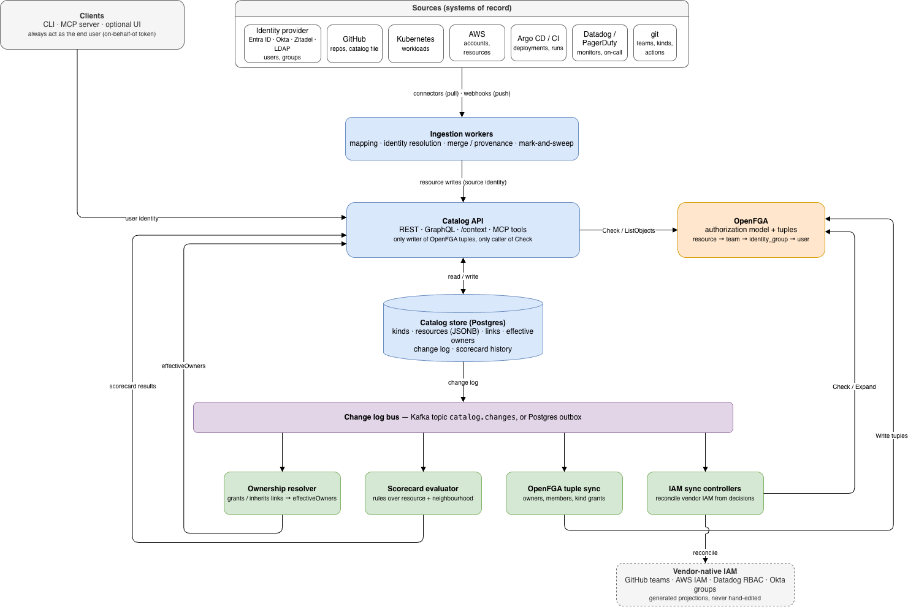

# Service Catalog

The resource-and-link store at the centre of the platform: ingested from
many sources, queried by agents, reports, scorecards and self-service actions,
with access derived from the graph itself (resource → owning team → identity group →
member).

This is the detailed design of Layer 3 in
[`../platform-abstraction/`](../platform-abstraction/README.md).

| Quadrant | Question it answers | Document |
|---|---|---|
| Reference | "What exactly is the schema / auth model / API?" | [reference.md](./reference.md) |
| Explanation | "Why is it built this way?" | [explanation.md](./explanation.md) |

To see the model working, open the
[ownership demo](../../demos/service-catalog-ownership/): a worked graph of
people, identity groups, teams, systems, components and real infrastructure (a
GitHub repo, a Kubernetes workload, an SQS queue, an RDS instance), with the
ownership resolver, the visibility rules and the OpenFGA tuples computed live.
Open `index.html` in a browser. No build, no dependencies, no network calls.

The PostgreSQL schema behind it is designed in
[`../data-store/`](../data-store/README.md).

## Diagram

Exported from draw.io with the source embedded. Open the PNG in
[diagrams.net](https://app.diagrams.net) to edit.
