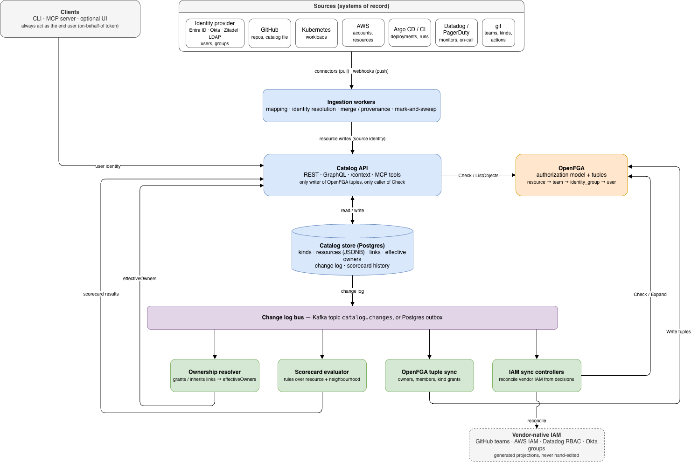

# Service Catalog reference

Precise specs for the catalog: schemas, the authorization model, ingestion
rules, the API. No rationale here; see [explanation.md](./explanation.md) for
why it is built this way. To see the model working, open the
[ownership demo](../../demos/service-catalog-ownership/).

Contents:

- [Kinds](#kinds)
- [Resources](#resources)
- [Built-in kinds](#built-in-kinds)
- [Ownership resolution](#ownership-resolution)
- [Link integrity](#link-integrity)
- [Authorization model](#authorization-model)
- [Visibility](#visibility)
- [Enforcement points](#enforcement-points)
- [Group membership freshness](#group-membership-freshness)
- [Ingestion](#ingestion)
- [Query API](#query-api)
- [Derived data](#derived-data)
- [Storage](#storage)

---

## Kinds

A kind is a versioned document. Properties are JSON Schema; links are
first-class, not just string properties that happen to hold an id.

```yaml
kind: kind
identifier: component
title: Component
description: A deployable unit of software (service, job, library)
schema:
  properties:
    lifecycle: { type: string, enum: [experimental, production, deprecated] }
    tier:      { type: string, enum: [tier-1, tier-2, tier-3] }
    language:  { type: string }
    repoUrl:   { type: string, format: uri }
  required: [lifecycle]
links:
  owner:
    target: team
    many: false
    required: false          # may be inherited, see Ownership resolution
    ownership: grants        # this link *defines* the owner of this resource
  system:
    target: system
    many: false
    ownership: inherits      # if no direct owner, inherit from the system
  dependsOn:
    target: component
    many: true
  repo:
    target: repository
    many: false
visibility: owner           # owner | org   (default: owner, see Visibility)
identity:
  # how ingestion resolves "which resource is this" — see Identity resolution
  keys: [repoUrl]
```

Rules:

- `identifier` is immutable. Properties are additive within a major version;
  removing or retyping a property is a new major version and requires a
  migration step that rewrites existing resources.
- A link declares `target` (kind id), `many`, `required`, and the
  `ownership` role (`grants`, `inherits`, or none). At most one link per
  kind may be `ownership: grants`.
- `visibility` sets the default read rule for the kind's resources.
- Every document's `kind:` field names the kind it is an instance of, the way
  `kind:` works in Kubernetes. A kind definition is itself a resource of the
  built-in kind `kind`, so the same audit, API and permission path applies to
  schema changes.

## Resources

```yaml
kind: component
identifier: checkout-service          # unique within the kind
title: Checkout Service
properties:
  lifecycle: production
  tier: tier-1
  language: go
  repoUrl: https://github.com/acme/checkout-service
links:
  owner: team:payments
  system: system:commerce
  dependsOn: [component:cart-service, component:pricing-service]
  repo: repository:github/acme/checkout-service
# server-managed:
meta:
  createdAt: 2026-11-12T09:14:03Z
  updatedAt: 2026-11-12T10:02:11Z
  sources:                             # provenance per source, see Merging and provenance
    - { source: github, lastSeenAt: 2026-11-12T10:02:11Z, externalId: "R_kgDOAbc" }
    - { source: manual, lastSeenAt: 2026-10-01T08:00:00Z }
  propertyProvenance:
    lifecycle: manual
    language: github
    repoUrl: github
  effectiveOwners: [team:payments]     # derived, see Ownership resolution
```

Resource references are `<kind>:<identifier>`. That string is the stable id
used by the API, OpenFGA tuples, and every downstream consumer.

## Built-in kinds

The platform ships these; they can be extended but not removed, because the
permission model depends on them.

| Kind | What it is | Ingested from |
|---|---|---|
| `user` | A person or service principal | Identity provider (Entra ID, Okta, Zitadel, ...) |
| `identity_group` | A group whose membership the identity provider asserts. Has `members: [user \| identity_group]` (where the provider nests groups, nesting is kept; flattening happens in the policy engine, not here) | Identity provider |
| `team` | The organisational unit that owns things. Has `backedBy: [identity_group]` (one or more) | HR system for the record, identity provider for membership, on-call tool for corroboration — never git ([Where team and system come from](./explanation.md#where-team-and-system-come-from)) |
| `kind` | Kind definitions themselves | Manual / git |
| `action` | Self-service action definition ([Self-service actions](#self-service-actions)) | Manual / git |
| `action_run` | One invocation of an action | Action runner |
| `scorecard` | Scorecard definition ([Scorecards](#scorecards)) | Manual / git |
| `source` | An ingestion source and its mapping ([Source mapping](#source-mapping)) | Manual / git |

### Sources of `team` and `system`

`team` is assembled from three sources, merged with the ordinary provenance
rules ([Merging and provenance](#merging-and-provenance)):

| Fact | Source | Why that one |
|---|---|---|
| existence, name, parent unit, cost centre, manager | HR system (Workday, Personio, HiBob, ...) | the organisation's own record of its units, with a stable `orgUnitId` to key on |
| membership | identity provider ([Group membership freshness](#group-membership-freshness)) | already the source for `identity_group`; joined to the team by an org-unit attribute carried on the group, not by a name pattern |
| who is accountable for production right now | on-call / incident tool (PagerDuty, Opsgenie, ...) | the one place where being wrong hurts within the hour, so it is the freshest thing in the organisation |

`identity.keys: [orgUnitId]`, so the team survives a rename in any of the three.

`system` membership is declared by components (the catalog file in each
repository names its system) and ingested from GitHub; the `system` resource is
created on first reference by dangling-edge resolution
([Link integrity](#link-integrity)) and flagged `meta.unmatched` until claimed.
Its descriptive properties and `owner` link come from the portfolio or product
tool where one exists, otherwise from a catalog-owned override.

Why these sources and not git: [explanation.md](./explanation.md#where-team-and-system-come-from).

## Ownership resolution

Ownership is never a free-text field. It is computed:

1. If the resource has a link with `ownership: grants` set (e.g.
   `component.owner`), its target is the owner.
2. Otherwise, follow each link with `ownership: inherits` (e.g.
   `component.system`, `k8s_workload.component`, `aws_resource.component`) and
   take the owner(s) of the targets, recursively, with cycle detection and a
   depth limit.
3. If nothing resolves, the resource is **unowned**. Unowned is a first-class
   state: it shows up in reports, is scoreable, and by default is visible only
   to platform admins ([Visibility](#visibility)).

The result is written to `meta.effectiveOwners` and recomputed whenever the
resource, or anything on its inheritance path, changes. This single resolver is
the only place ownership logic lives. OpenFGA ([Authorization model](#authorization-model)) receives
`effectiveOwners` as plain tuples and does not re-derive it. The query layer
filters on the same column. One implementation, three consumers.

Example path: `aws_rds_instance:prod-checkout-db --component--> component:checkout-service --owner--> team:payments --backedBy--> identity_group:eng-payments --members--> user:alice`.

## Link integrity

- A link may point at a resource that does not exist yet (ingestion order
  is not controllable). Such edges are stored as **dangling** and resolved when
  the target appears. Dangling edges are reportable and never contribute to
  ownership.
- Deleting a resource leaves tombstones for its incoming links for a
  retention period, so a source that re-creates it (common with Kubernetes
  restarts, repo renames) reattaches cleanly.
- Cardinality (`many: false`) is validated on write.

## Authorization model

The catalog stores the facts. **Two evaluators** answer access questions from
them, using one model, and each is authoritative for a different set of
callers:

| Evaluator | Authoritative for | Relations |
|---|---|---|
| **SQL rule** in the catalog database ([`api.resource`](../data-store/reference.md#apiresource), `authz.viewer_*`) | the catalog's own reads and writes: get, search, list, graph traversal, agent context, reports, manual edits | `can_view`, `can_view_sensitive`, `can_edit`, `can_transfer` |
| **OpenFGA** | every other service: the platform API checking a capability request, action runners, gateways | every relation below, including `can_run_action` and `runner`, which exist only here |

Rules that keep them one model rather than two:

- **One writer of tuples.** The catalog's `openfga-sync` consumer is the only
  writer. The tuple set is a projection of the graph
  ([`authz.fga_tuples`](../data-store/reference.md#openfga-projection)), never
  edited in OpenFGA directly.
- **Ownership is resolved once.** Neither evaluator re-derives it: both read
  `effectiveOwners` ([Ownership resolution](#ownership-resolution)).
- **A model change is one pull request touching both.** It edits
  [`demos/data-store/fga/model.fga`](../../demos/data-store/fga/model.fga) (the
  block below is a copy, checked to be identical) and the SQL rule together.
- **Drift is a failing build.** The drift check
  ([data-store reference](../data-store/reference.md#drift-check)) evaluates
  both over the same tuples for every user, resource and shared relation, and
  runs in CI on every data-store change.

The model, as loaded into OpenFGA from `demos/data-store/fga/model.fga`:

```
model
  schema 1.1

type user

type identity_group
  relations
    define member: [user, identity_group#member]

type team
  relations
    define backed_by: [identity_group]
    define member: member from backed_by

type platform
  relations
    define admin: [user, identity_group#member]
    define auditor: [user, identity_group#member]

type kind
  relations
    define platform: [platform]
    define org_viewer: [user:*]
    define editor: [team#member, identity_group#member]
    define admin: admin from platform
    define auditor: auditor from platform

type resource
  relations
    define kind: [kind]
    define owner: [team]
    define owner_member: member from owner
    define can_view: owner_member or org_viewer from kind or editor from kind or admin from kind or auditor from kind
    define can_view_sensitive: owner_member or editor from kind or admin from kind or auditor from kind
    define can_edit: owner_member or editor from kind or admin from kind
    define can_run_action: owner_member or admin from kind
    define can_transfer: admin from kind

type action
  relations
    define kind: [kind]
    define runner: [team#member, identity_group#member]
```

Tuples written by the catalog, from the example in [Resources](#resources):

```
identity_group:eng-payments#member@user:alice
identity_group:eng-payments#member@identity_group:eng-payments-leads#member
team:payments#backed_by@identity_group:eng-payments
resource:component/checkout-service#kind@kind:component
resource:component/checkout-service#owner@team:payments
resource:aws_rds_instance/prod-checkout-db#owner@team:payments     # inherited, written by the resolver
resource:aws_rds_instance/prod-checkout-db#kind@kind:aws_rds_instance
kind:component#platform@platform:default
platform:default#admin@identity_group:platform-engineering#member
```

Because the resource type is generic (`resource`, not one OpenFGA type per
kind), adding a kind never changes the authorization model. The
kind-level OpenFGA relations (`org_viewer`, `editor`) are how a kind's
`visibility` and any wide grants are expressed.

## Visibility

Set per kind with `visibility`. Default is `owner`.

| `visibility` | Who can read | Typical use |
|---|---|---|
| `owner` (default) | owning team members, kind editors, platform admins/auditors | cloud resources, secrets metadata, cost data, anything with sensitive properties |
| `org` | any authenticated user | `team`, `system`, `component` *identity and ownership fields* |

`org` can be combined with **property-level sensitivity**: a kind may mark
properties `sensitivity: owner`, in which case the resource is listed to everyone
but those properties are redacted unless `can_view` passes. This is what lets
"everyone can see that checkout-service exists and payments owns it; only
payments sees its on-call rota and cost" work without per-resource rules.

## Enforcement points

| Path | Evaluator | Check |
|---|---|---|
| Catalog `GET /resources/{id}` | SQL | the row exists in `api.resource` for the viewer (`can_view`); sensitive properties need `can_view_sensitive` |
| Catalog search / list / graph traversal / agent context | SQL | filtered inside the query by `api.resource`, never by per-row OpenFGA calls |
| Catalog write (manual edit, API) | SQL | `can_edit`; changing an owner or any privileged (access-granting) link also needs `can_transfer` |
| Ingestion write | — | Source identity, not user identity. A `source` resource declares which kinds it may write and which properties it owns ([Merging and provenance](#merging-and-provenance)). |
| Scorecard / report read | SQL | same as search; reports aggregate only over resources the caller can view |
| Run action | OpenFGA | `Check(user, can_run_action, resource)` and, if the action has `runner` tuples, `Check(user, runner, action)`, by the action service |
| Any other service (platform API, gateways) | OpenFGA | `Check` / `ListObjects` on the relation it needs; never a query against the catalog database |

The two evaluators must give the same answer wherever both answer. That is
proven, not assumed: see the drift check.

## Group membership freshness

Membership is the one fact where staleness is a security issue. The identity
provider source therefore runs two cadences: a full reconciliation (hourly) and
an incremental feed every few minutes, using whatever the provider offers
(Entra ID delta queries or Graph change notifications, Okta System Log or event
hooks, Zitadel events API, LDAP persistent search or periodic diff). Removal
from a group propagates to OpenFGA within the incremental interval; this bound
is documented as an SLO and exposed on the provider's `source` resource, for
example `source:entra-id` or `source:okta`.

## Ingestion

### Sources

A source is a connector plus a mapping. Expected first-wave sources:

| Source | Kinds produced | Mode |
|---|---|---|
| Identity provider (Entra ID, Okta, Zitadel, LDAP) | `user`, `identity_group`, group membership | full + delta ([Group membership freshness](#group-membership-freshness)) |
| GitHub | `repository`, `component` (via a catalog file in the repo), the `system` each component declares, CODEOWNERS → `owner` hint | webhook + nightly full |
| Kubernetes (per cluster) | `k8s_cluster`, `k8s_namespace`, `k8s_workload`, `k8s_workload --component-->` via a label | watch + periodic resync |
| AWS (per account) | `aws_account`, one `aws_*` kind per service, `--component-->` via tag | Config/CloudTrail events + daily full |
| Argo CD / CI | `deployment`, `pipeline_run` | webhook |
| HR system (Workday, Personio, HiBob, ...) | `team` org units: name, hierarchy, cost centre, manager ([Where team and system come from](./explanation.md#where-team-and-system-come-from)) | nightly full, webhook where offered |
| Datadog / PagerDuty / Opsgenie | `monitor`, `oncall_schedule`, `incident`, and the `team` rota it corroborates | webhook + periodic |
| Portfolio / product tool (where one exists) | `system` properties and its `owner` link | periodic full |
| Manual / git | kinds, actions, scorecards, source mappings, ownership overrides — *not* team or system records ([Where team and system come from](./explanation.md#where-team-and-system-come-from)) | git push (reconciled on merge) |

### Source mapping

Each source has a declarative mapping from source payload to resources. The
mapping is data on the `source` resource, so adding a field or a new kind
from an existing source is a config change:

```yaml
kind: source
identifier: kubernetes-prod-eu
connector: kubernetes
config: { cluster: prod-eu, watch: [Deployment, StatefulSet, CronJob] }
mapping:
  - match: Deployment             # source-side object type
    kind: k8s_workload            # catalog kind it becomes
    identifier: "{{ .metadata.namespace }}/{{ .metadata.name }}@prod-eu"
    title: "{{ .metadata.name }}"
    properties:
      replicas: "{{ .spec.replicas }}"
      image: "{{ (index .spec.template.spec.containers 0).image }}"
    links:
      namespace: "k8s_namespace:prod-eu/{{ .metadata.namespace }}"
      component: '{{ with index .metadata.labels "platform.acme.io/component" }}component:{{ . }}{{ end }}'
writes:
  kinds: [k8s_cluster, k8s_namespace, k8s_workload]
  ownsProperties: { k8s_workload: [replicas, image] }
```

The template language is a sandboxed expression language (JQ or CEL; pick one
and use it everywhere, including scorecards). The connector is responsible for
fetching and change detection; the mapping is responsible for shape.

### Identity resolution

The hard problem in multi-source ingestion is "is this the same thing". Rules,
in order:

1. The mapping produces an explicit `identifier` — exact match.
2. Otherwise, the kind's `identity.keys` (e.g. `component.repoUrl`) are
   matched against existing resources.
3. Otherwise, a new resource is created and flagged `meta.unmatched: true` for
   the source, so it shows up in a "possible duplicates" report rather than
   silently forking the graph.

Cross-source links use the same mechanism in the link direction: the
Kubernetes label `platform.acme.io/component` and the AWS tag `platform:component`
are the convention by which infrastructure declares which component it belongs
to. That label is what makes ownership inheritance ([Ownership resolution](#ownership-resolution)) reach cloud resources.

### Merging and provenance

- Each source **owns** the properties it declares in `writes.ownsProperties`
  and may not overwrite others. The `manual` source owns anything not claimed
  by another source. If two sources claim the same property, kind config
  sets a priority; the loser's value is retained in provenance but not applied.
- Every applied value records `propertyProvenance[prop] = source`, and every
  source that has seen the resource records `lastSeenAt`.
- Links are unioned across sources; a link is removed only when no

### Deletion and reconciliation

- Event-driven sources mark deletions explicitly.
- Full-sync sources use mark-and-sweep: resources not seen in a completed full
  run are marked `stale` by that source; when no source has seen a resource for
  the kind's `staleAfter` window it is soft-deleted (tombstoned, hidden
  from queries, restorable). Hard deletion is a separate retention job.
- A full run that produces far fewer resources than the last one (configurable
  threshold, default 20% drop) is held for review instead of swept. This is
  the guard against a broken credential deleting half the map.

### Change log

Every write (ingestion or manual) appends to an immutable change log:
`(resourceRef, version, actor{user|source}, timestamp, diff, reason)`. The log
is the audit trail, the input to OpenFGA tuple sync, and the event stream for
derived data. It is published to a message bus (Kafka topic `catalog.changes`,
or the outbox pattern on the catalog DB if Kafka is not already run) so
consumers never poll.

## Query API

### API surface

- **REST** for CRUD and ingestion: `/kinds`, `/resources`, `/sources`,
  `/actions`, `/changes`.
- **GraphQL** for reads: typed per kind (schema generated from
  kinds), link traversal with depth and direction, filters on
  properties, full-text search, and `effectiveOwners` on every resource.
- **Search**: full-text over title/identifier/selected properties, scoped by
  kind, always permission-filtered.

Every response carries freshness: `meta.updatedAt` and per-source `lastSeenAt`
so a caller can decide whether a fact is recent enough.

### Agent context

Agents need a small, relevant, token-bounded slice of the graph, not the whole
thing. One endpoint does that:

```
POST /context
{ "focus": ["component:checkout-service"],
  "depth": 2,
  "include": ["owner", "dependsOn", "k8s_workload", "incident", "scorecard"],
  "budget": { "maxResources": 60 } }
```

It returns the focus resources, their neighbourhood by the listed links (in
both directions), current scorecard results, open incidents, and the freshness
of each fact, in a compact JSON shape. Permission filtering happens before the
budget is applied, so an agent never learns of a resource's existence through
truncation counts.

The MCP server exposes this as tools: `catalog_search`, `catalog_get`,
`catalog_context`, `catalog_who_owns`, `catalog_changes_since`,
`catalog_run_action`. All calls carry the end user's identity ([Enforcement points](#enforcement-points)).

## Derived data

### Scorecards

A scorecard is rules over a resource and its neighbourhood, evaluated on
change. `appliesTo` names the kind it scores.

```yaml
kind: scorecard
identifier: production-readiness
appliesTo: component
filter: 'resource.properties.lifecycle == "production"'
levels: [bronze, silver, gold]
rules:
  - id: has-owner
    level: bronze
    expr: 'size(resource.meta.effectiveOwners) > 0'
  - id: has-oncall
    level: silver
    expr: 'size(linked(resource, "owner").linked("oncall_schedule")) > 0'
  - id: no-critical-vulns
    level: gold
    expr: 'linked(resource, "repo").properties.criticalVulnerabilities == 0'
```

Results are stored as a derived property set on the resource
(`scorecards.production-readiness = { level: silver, rules: {...}, evaluatedAt }`)
and in a history table, so trend reports are a query, not a recomputation.
Evaluation is triggered from the change log, scoped to resources whose inputs
changed. Scorecard rules use the same expression language as mappings ([Source mapping](#source-mapping)).

### Reports

Reports are saved GraphQL queries plus an aggregation, run on a schedule or on
demand, permission-filtered to the viewer. Typical: ownership coverage per
kind, unowned resources per AWS account, scorecard distribution per team,
stale resources per source. No separate reporting store; the catalog's indexes
and the scorecard history table are the inputs.

### Self-service actions

An action is a form bound to a kind and a runner:

```yaml
kind: action
identifier: scaffold-service
appliesTo: component
trigger: create               # create | day-2 (on an existing resource) | delete
inputs:
  schema:
    properties:
      name: { type: string, pattern: "^[a-z0-9-]+$" }
      team: { type: string, kind: team }       # link-typed input, filtered to teams the caller is a member of
      template: { type: string, enum: [go-service, python-job] }
runner:
  type: argo-workflows        # or github-actions
  ref: platform/scaffold-service
  payload: '{ "name": inputs.name, "team": inputs.team, "requestedBy": user.id }'
permissions:
  # defaults to can_run_action on the target resource (day-2) or kind editor (create)
```

Invoking an action creates an `action_run` resource linked to the target and the
caller, dispatches to the runner, and the runner reports status back by
updating that resource (via the ingestion API, as a `source`). The `action_run`
inherits ownership from its target, so visibility of runs follows the same
rules as everything else. Runners are existing workflow engines; the catalog
never executes anything itself.

## Storage



The PNG has the draw.io source embedded; open it directly in
[diagrams.net](https://app.diagrams.net) or the VS Code Draw.io extension to edit.

**Store: Postgres.** Resources as rows with a JSONB `properties` column and a
GIN index; links as a `(from_ref, link, to_ref, source)` table;
`effective_owners` as an indexed array column; change log as an append-only
table partitioned by month. Full-text search via `tsvector` initially, moving
to OpenSearch only if relevance or scale demands it. Graph traversals for the
depths the catalog needs (2–4 hops) are recursive CTEs over the links
table; a dedicated graph database is not justified until traversal patterns
prove otherwise.

**Sizing assumptions:** up to ~500k resources, ~5M links, ~100k
users/groups, ~10k changes/minute at ingestion peaks. Postgres handles this
comfortably on one primary with read replicas for the query path.

Why Postgres and not DataHub: [explanation.md](./explanation.md#why-postgres-and-not-datahub).

The full schema (tables, functions, views, roles) is specified in
[`../data-store/reference.md`](../data-store/reference.md) and runs in
[`demos/data-store/`](../../demos/data-store/).
